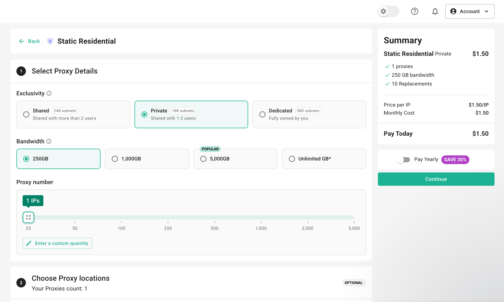
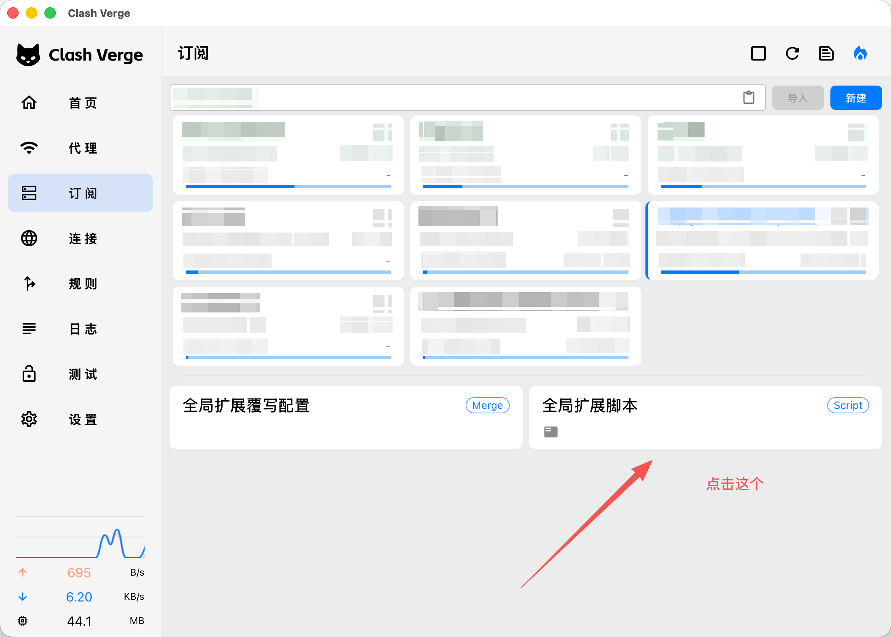
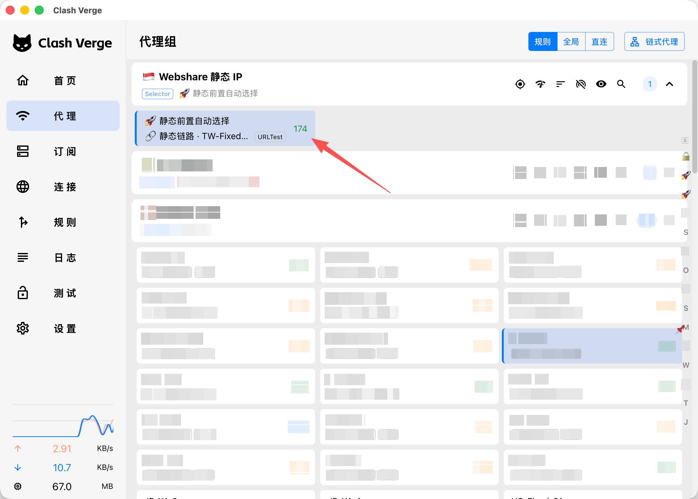
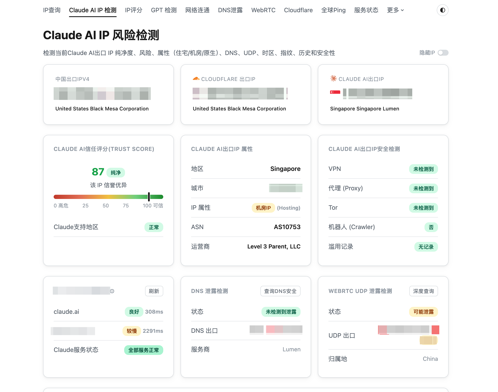
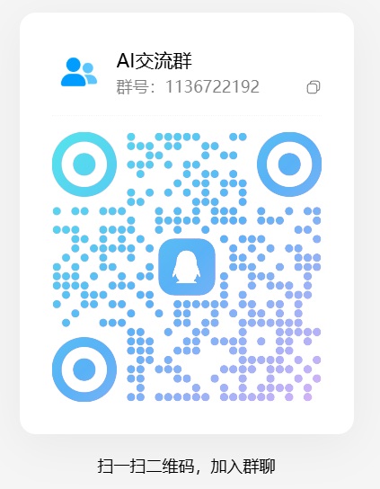
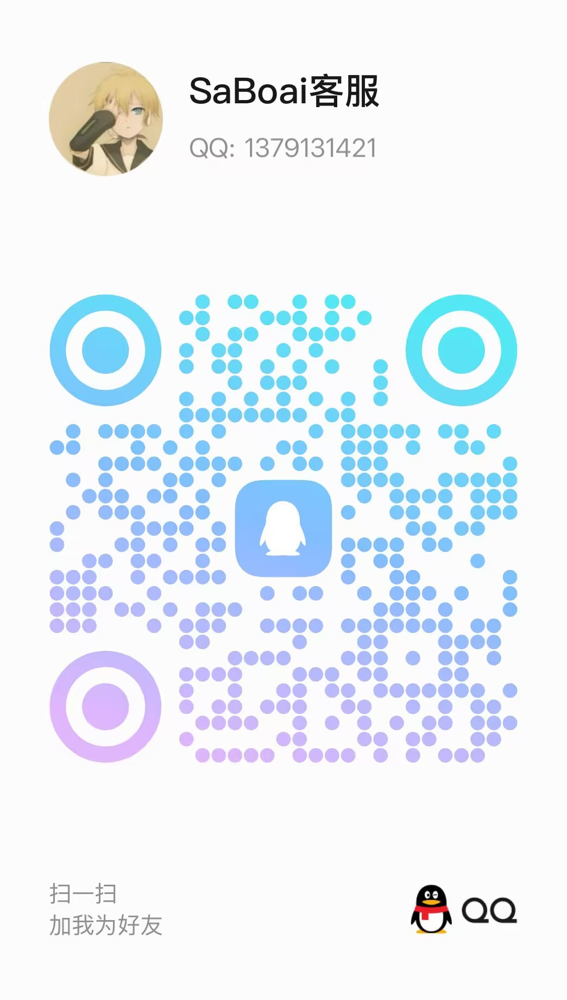

# Clash Verge 静态 IP 分流

适用于电脑端 Clash Verge Rev。用自己的机场订阅连接 HTTP 或 SOCKS5 静态代理，给 X、ChatGPT、Claude、Gemini 等服务提供固定出口。

| 流量 | 出口 |
| --- | --- |
| X（含视频）、ChatGPT、Claude、Gemini、Cursor 等脚本中列出的域名 | 静态代理 |
| YouTube（含视频、接口和图片） | 普通代理 |
| 其他流量 | 优先使用订阅自己的规则；代理兜底使用普通自动选择 |

## 按需调整

这个脚本提供一套「订阅节点作为前置，再连接静态代理」的分流思路。上面的规则可以作为起点，你可以根据自己的订阅、静态代理和日常使用场景调整。

- **分流策略**：按需增删域名，决定哪些网站走静态出口，哪些继续走普通代理。例如，只让 X 和 ChatGPT 走静态出口，其他服务沿用订阅规则。
- **前置节点**：默认用订阅中的所有节点生成静态链路。你可以在脚本生成 `chains` 的位置筛选候选节点，只让常用地区或实测能稳定连到静态代理的节点参与选线。

## 使用教程

**哪一步看不懂，直接让 AI 按这份教程帮你操作就行。**

准备一个已经导入 Clash Verge Rev 的订阅，以及你自己的 HTTP 或 SOCKS5 静态代理。订阅的 `proxies` 里需要有节点；只通过 `proxy-providers` 加载节点的订阅需要先展开。

如果你还没有静态代理，可以参考下面的 Webshare 配置示例。已有静态代理的话，直接使用你自己的服务即可。

### Webshare 静态 IP 选购示例

进入 Webshare 的套餐配置页面后，按截图选择以下选项。

| 页面选项 | 选择 |
| --- | --- |
| 产品 | `Static Residential`（静态住宅代理） |
| Exclusivity | `Private` |
| Bandwidth | `250 GB` |
| Proxy number | 点击 `Enter a custom quantity`，输入 `1`，并确认右侧 Summary 显示 1 个代理 |
| Pay Yearly | 关闭，按月付款 |

截图中的 **Monthly Cost（月费）和 Pay Today（本次付款）均为 1.50 美元**。如果金额不同，先逐项核对产品、类型、流量、IP 数量和付款周期，尤其注意滑块的第一个刻度是 25，要用自定义数量填 1。选项都一致时，以 Webshare 结账页显示的金额为准。

### 1. 复制完整脚本

打开 [clash-verge-static-ip.js](clash-verge-static-ip.js)，点击文件上方的「复制原始文件」图标，或点「Raw」打开纯文本后全选复制。

### 2. 粘贴到全局扩展脚本

在 Clash Verge Rev 左侧点击「订阅」，打开页面底部右侧的「全局扩展脚本」（Script），位置见下图。如果编辑器里已有脚本，先复制一份保存到本地，再全选并粘贴刚才复制的完整脚本。

### 3. 换成你自己的静态 IP 和账号

**保存前，务必修改脚本顶部的 `staticProxy`。把示例占位值换成你自己购买或搭建的静态代理信息。**

| 字段 | 填写内容 |
| --- | --- |
| `type` | 供应商提供的协议，填写 `"http"` 或 `"socks5"` |
| `server` | 你自己的静态代理 IP 或主机名，替换 `YOUR_PROXY_HOST`。只填地址，端口另填 |
| `port` | 你自己的代理端口，替换示例中的 `8080`，保持为数字 |
| `username` | 你自己的代理用户名，替换 `YOUR_PROXY_USERNAME` |
| `password` | 你自己的代理密码，替换 `YOUR_PROXY_PASSWORD` |

如果供应商要求 HTTP 代理入口使用 TLS，取消 `tls: true` 这一行的注释。填好后的脚本含明文凭据，请只保存在自己的设备。

### 4. 在 Clash Verge 里测试

保存脚本，重新加载当前订阅，再打开左侧「代理」页面，选择右上角的「规则」模式。找到「🔒 静态出口自动选择」，点击组右侧的测速按钮。如果静态链路显示了延迟数字（例如图中的 174 ms），就说明这条链路已连通。

截图里的「静态前置自动选择」对应公开脚本里的「静态出口自动选择」。

界面位置可参照 [Clash Verge Rev 扩展配置与脚本文档](https://www.clashverge.dev/guide/extend.html)。

#### 核对 Claude 的出口 IP

静态链路测速通过后，在浏览器打开 [Claude AI IP 检测](https://ip.net.coffee/claude/)。看页面右上方的「Claude AI 出口 IP」卡片，确认显示的地址与你配置的静态出口 IP 一致。如果地址不同，可以在 Clash Verge 的「连接」页面检查 Claude 相关连接是否命中「静态出口自动选择」。

## 自动选线

每个订阅节点都会生成一条「订阅节点 → 静态代理」链路。静态组每 60 秒检测完整链路，所有静态链路不可用时相关请求会失败。普通组每 300 秒检测订阅节点。静态目标使用 TCP，匹配静态域名的 UDP 流量会被拒绝。YouTube 规则优先于 Google 的通用规则。[Mihomo 链式代理文档](https://wiki.metacubex.one/config/proxies/dialer-proxy/)

需要调整域名时，在脚本顶部维护 `staticDomains`、`staticExact`、`youtubeDomains` 和 `youtubeExact`。前两组分别按域名后缀和完整域名匹配静态流量，后两组用于 YouTube 的普通线路。

## QQ 交流群

请用 QQ 扫一扫加入「AI交流群」。**已入群的朋友请勿重复加入。**

### 添加我的 QQ

如果群满或二维码过期，可以扫下方二维码添加我的 QQ（SaBoai）。

